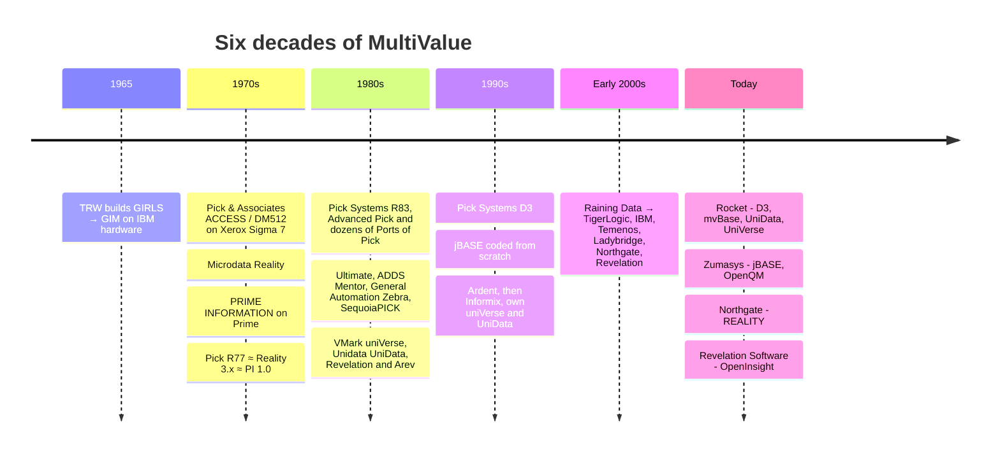
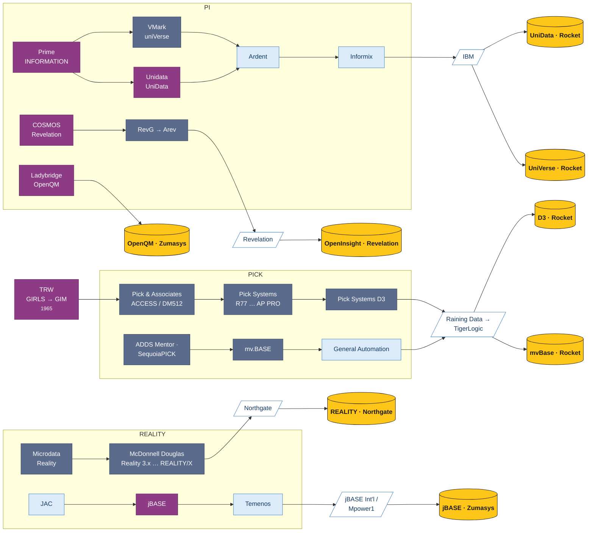

```mermaid
flowchart LR
  subgraph TRW["TRW · 1965"]
    direction TB
    n0(["IBM (hardware)"]):::hw
    n1["GIRLS → GIM<br/><small>TRW</small>"]:::scratch
    n2["GIM-II<br/><small>TRW</small>"]:::prod
    n3["CIA"]:::co
    n4(["PDP-11 (hardware)"]):::hw
    n5["GIM-I<br/><small>TRW</small>"]:::prod
    n6["NASA"]:::co
    n7(["Univac (hardware)"]):::hw
    n8["RIS<br/><small>General Analytics</small>"]:::prod
    n9["ITDS<br/><small>US Army</small>"]:::prod
  end
  subgraph PICK["PICK branch"]
    n10(["Xerox Sigma 7 (hardware)"]):::hw
    n11["ACCESS, DM512<br/><small>Pick & Associates</small>"]:::prod
    n12["Multi-6"]:::prod
    n13["Pick Systems R77 / R80 / R81"]:::prod
    n14["Evolution"]:::prod
    n15["Omnus → ICC"]:::prod
    n16["Pick Systems R83 / R84 / OA / Adv Pick / AP PRO"]:::prod
    n17["Pick AT"]:::prod
    n18["Pick Blue"]:::prod
    n19["D3<br/><small>Pick Systems</small>"]:::prod
    n20["PickAX"]:::co
    n34(["Honeywell (hardware)"]):::hw
    n38(["Intertechnique (hardware)"]):::hw
    n39["Réalité<br/><small>Intertechnique</small>"]:::prod
    n40["IN2"]:::co
    n41["Nixdorf<br/><small>Siemens</small>"]:::prod
    ports{{"32 Ports of Pick<br/><small>see list below</small>"}}:::port
  end
  subgraph SMA["Other SMA Pick"]
    n21["Zebra<br/><small>General Automation</small>"]:::prod
    n22["R91<br/><small>General Automation</small>"]:::prod
    n23["Power 95<br/><small>General Automation</small>"]:::prod
    n24["SequoiaPICK<br/><small>COST</small>"]:::prod
    n25["mvEnterprise"]:::prod
    n26["mv.PRO"]:::prod
    n27["Mentor<br/><small>ADDS</small>"]:::prod
    n28["M-PC/OS<br/><small>NCR ADDS</small>"]:::prod
    n29["MentorPRO<br/><small>NCR ADDS</small>"]:::prod
    n30["M-O/E"]:::prod
    n31["mv.BASE"]:::prod
    n32["UniVision<br/><small>EDP</small>"]:::scratch
    n33["General Automation (2000s)"]:::co
    n35["Ultimate"]:::prod
    n36["Ultplus"]:::prod
    n37["OSS → Nextech"]:::co
  end
  subgraph REALITY["REALITY branch"]
    n42(["Microdata (hardware)"]):::hw
    n43["Reality (Microdata)"]:::prod
    n44["Reality 3.x … 5.x … 7.x … REALITY/X<br/><small>Microdata</small>"]:::prod
    n45["(PC)microReality"]:::prod
    n46["M9000/Sequel/Sequoia"]:::prod
    n47["Pegasus"]:::prod
    n48["Spirit"]:::prod
    n49["JAC"]:::co
    n50["jBASE<br/><small>jBASE Software</small>"]:::scratch
    n51["jBASE → TAFC<br/><small>Temenos</small>"]:::prod
    n52["TAFJ<br/><small>Temenos</small>"]:::scratch
    n53["Caché<br/><small>InterSystems</small>"]:::scratch
    n54["Reality (ADP)"]:::prod
    n55["CoRA<br/><small>ADP</small>"]:::prod
    n56["Devcom"]:::co
    n57["VAR Consortium"]:::co
  end
  subgraph PI["PI branch (PRIME INFORMATION)"]
    n58(["PRIME (hardware)"]):::hw
    n59["Information<br/><small>Prime</small>"]:::scratch
    n60["PI/Open"]:::prod
    n61["ComputerVision"]:::co
    n62["Revelation (COSMOS)"]:::scratch
    n63["RevG<br/><small>Revelation</small>"]:::prod
    n64["Arev"]:::prod
    n65["PI/PC"]:::prod
    n66["OpenQM<br/><small>Ladybridge</small>"]:::scratch
    n67["ScarletDME"]:::prod
    n68["URMA → mvON"]:::scratch
    n69["Netbasic → MVON<br/><small>ProSolutions</small>"]:::scratch
    n70["MVON<br/><small>ONgroup</small>"]:::prod
    n71["UPIX<br/><small>Alfa</small>"]:::scratch
    n72["uniVerse<br/><small>VMark</small>"]:::prod
    n73["FIRESTORM<br/><small>Data General</small>"]:::prod
    n74["pcVerse<br/><small>Profile</small>"]:::prod
    n75["Ardent"]:::co
    n76["Informix"]:::co
    n77["UniData<br/><small>Unidata</small>"]:::scratch
    n78["Pacific Unidata"]:::co
  end
  subgraph V2000["Vendors in the early 2000s"]
    n79[/"Raining Data → TigerLogic"/]:::vendor
    n80[/"Temenos → jBASE Int'l / Mpower1"/]:::vendor
    n81[/"Ladybridge (2000s)"/]:::vendor
    n82[/"Northgate Information Solutions"/]:::vendor
    n83[/"Revelation"/]:::vendor
    n84[/"IBM"/]:::vendor
  end
  subgraph NOW["Current MultiValue databases"]
    n85[("D3 (Rocket)<br/><small>Rocket</small>")]:::now
    n86[("mvBase<br/><small>Rocket</small>")]:::now
    n87[("jBASE (Zumasys)<br/><small>Zumasys</small>")]:::now
    n88[("OpenQM (Zumasys)<br/><small>Zumasys</small>")]:::now
    n89[("REALITY<br/><small>Northgate (NEC)</small>")]:::now
    n90[("OpenInsight<br/><small>Revelation Software</small>")]:::now
    n91[("UniData (Rocket)<br/><small>Rocket</small>")]:::now
    n92[("UniVerse<br/><small>Rocket</small>")]:::now
  end
  n0 --> n1
  n1 --> n5
  n1 --> n2
  n1 --> n8
  n1 --> n9
  n1 --> n11
  n2 --> n3
  n5 --> n6
  n8 --> n11
  n10 --> n11
  n11 --> n13
  n11 --> n12
  n13 --> n14
  n13 --> n15
  n13 --> n16
  n16 --> n17
  n16 --> n18
  n16 --> n19
  n19 --> n20
  n19 --> n79
  n20 --> n79
  n21 --> n22
  n21 --> n23
  n21 --> n33
  n24 --> n25
  n25 --> n26
  n25 --> n33
  n26 --> n33
  n27 --> n28
  n27 --> n29
  n27 --> n31
  n28 --> n30
  n25 --> n31
  n31 --> n33
  n31 --> n86
  n22 --> n33
  n23 --> n33
  n33 --> n79
  n34 --> n35
  n35 --> n36
  n36 --> n37
  n38 --> n39
  n39 --> n40
  n39 --> n41
  n40 --> n41
  n42 --> n43
  n43 --> n44
  n43 --> n46
  n43 --> n45
  n44 --> n82
  n46 --> n47
  n46 --> n48
  n49 --> n50
  n50 --> n51
  n50 --> n80
  n51 --> n52
  n43 --> n54
  n54 --> n55
  n50 --> n55
  n58 --> n59
  n59 --> n60
  n59 --> n61
  n59 --> n71
  n59 --> n72
  n59 --> n77
  n60 --> n61
  n62 --> n63
  n62 --> n64
  n62 --> n90
  n63 --> n64
  n63 --> n65
  n64 --> n90
  n66 --> n67
  n66 --> n81
  n68 --> n70
  n69 --> n70
  n71 --> n72
  n72 --> n73
  n72 --> n74
  n72 --> n75
  n72 --> n92
  n77 --> n75
  n75 --> n76
  n76 --> n84
  n77 --> n78
  n77 --> n84
  n78 --> n84
  n79 --> n85
  n79 --> n86
  n80 --> n87
  n81 --> n88
  n82 --> n89
  n64 --> n83
  n83 --> n90
  n84 --> n91
  n84 --> n92
  n11 -.-> ports
  classDef hw fill:#E8F1DA,stroke:#6A9A3A,color:#24400F
  classDef co fill:#DCEBFA,stroke:#4A87C5,color:#123A63
  classDef prod fill:#5B6B8C,stroke:#3E4B66,color:#FFFFFF
  classDef scratch fill:#8E3B85,stroke:#6A2B63,color:#FFFFFF
  classDef vendor fill:#FFFFFF,stroke:#4A87C5,color:#123A63
  classDef now fill:#FFC61A,stroke:#1D1A14,color:#1D1A14,font-weight:bold
  classDef port fill:#F3EEE2,stroke:#A8A193,color:#2A2620
```

Every MultiValue database in use today descends from one of four branches: **TRW**, **PICK**, **REALITY** and **PI** (PRIME INFORMATION). Before they diverged, their features lined up closely: Pick R77 ≈ REALITY 3.x ≈ PI 1.0.

## At a glance

## The main lines

How each database you can buy today got there.





## The full family tree

Every product and company on the chart, read from left to right. Each arrow means that ownership of the product (its IP) or its source code passed on. Colours follow the original chart:

| Colour | Meaning |
|---|---|
| Purple | Coded from scratch |
| Slate | Product with the MultiValue query language |
| Light blue | Company that owned the IP |
| Green, rounded | Hardware it ran on |
| White, slanted | Vendor in the early 2000s |
| Yellow, cylinder | MultiValue database you can buy today |





> On a small screen, open the diagram on its own or zoom in: it holds 93 products and companies.
{: .prompt-tip }

## Where they are today

| Database | Vendor | Lineage |
|---|---|---|
| D3 | Rocket | Current MultiValue database from Rocket, descended from Pick Systems' D3. |
| mvBase | Rocket | Current MultiValue database from Rocket, descended from mv.BASE. |
| jBASE | Zumasys | Current MultiValue database from Zumasys, descended from jBASE. |
| OpenQM | Zumasys | Current MultiValue database from Zumasys, descended from Ladybridge's OpenQM. |
| REALITY | Northgate (NEC) | Current MultiValue database from Northgate Public Services (an NEC company), descended from Microdata's Reality. |
| OpenInsight | Revelation Software | Current MultiValue database from Revelation Software, descended from Revelation and Arev. |
| UniData | Rocket | Current MultiValue database from Rocket, descended from Unidata's UniData via IBM. |
| UniVerse | Rocket | Current MultiValue database from Rocket, descended from VMark's uniVerse via IBM. |

## The Ports of Pick

From the 1970s to the 1990s, Pick was licensed to and ported by many hardware makers. An arrow shows a later name or owner.

All 32 ports

- Datamedia
- Xmark
- Altos → Acer
- C.Itoh (CIE) → GA
- CDI IBM Series/1
- WICAT
- Fujitsu → Alpha Micro
- Fujitsu España
- Tau/Nippon
- Pick Vulture
- MDC Eagle board
- DEC VAX & MicroVAX
- SMI IBM 370, 4300, 9370
- Sanyo/ICON AT&T & BSD UNIX
- Upboard
- Pertec Sabre → Scan-Optics
- ICL Clan → STC
- Archford Excalibur
- IBC
- Electronique Serge Dassault
- Seattle OS → Seattle Labs Pick Blue IBM RT/RS6000
- Pinnacle
- Toltec → Edge → Edgcore → Arix
- Rexon Summit → Alpha Micro Pick 64+ → Sequoia → GA
- Aston Crystal Excel
- Pyramid → Siemens
- DS-Rabbit
- Data General
- Encore
- Climax Sunshine
- Stratus
- XEROX Brazil

---

Data: `_data/mv.json` in this site's repository, transcribed from the MultiValue history chart. Tools that keep these systems productive today: [MVBU and MVBA]({{ '/modernization/' | relative_url }}).
