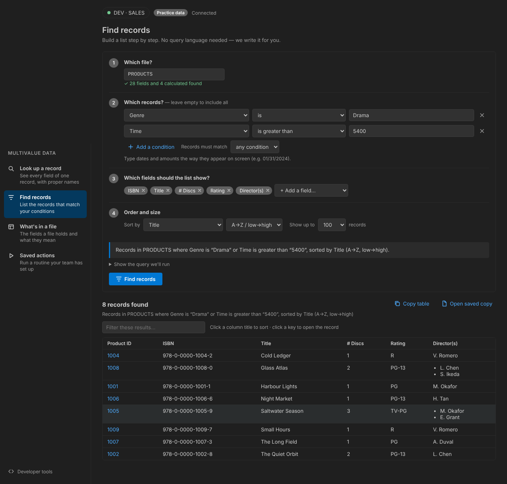
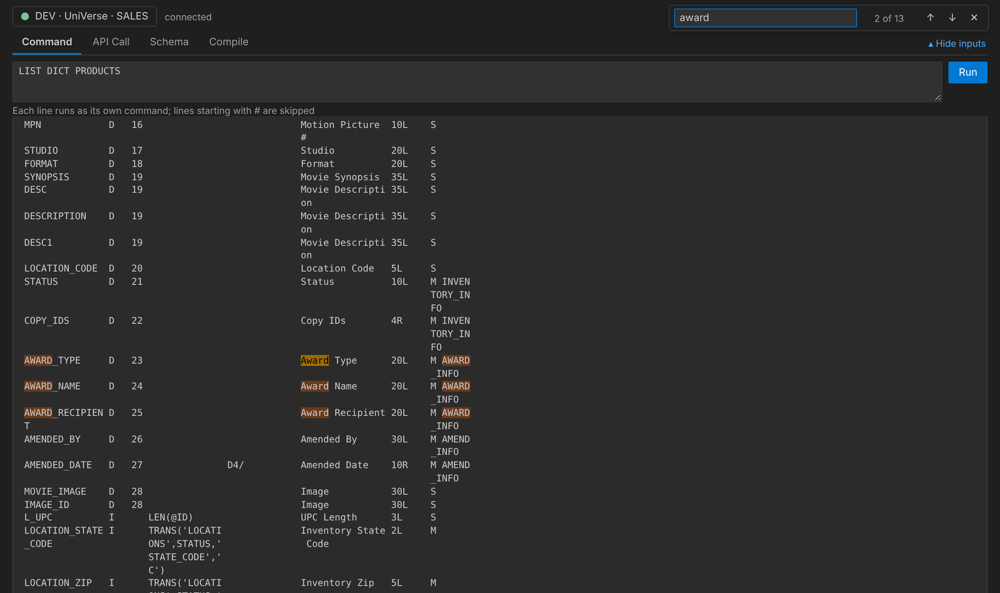

**MultiValue Basic Utility (MVBU)** is an extension for Chrome, Edge and Visual Studio Code that works with Rocket **UniVerse** and **UniData**. Business analysts use it to look up and find records in plain language. Developers use it to run commands, call catalogued subroutines, inspect file dictionaries and compile programs. Results are shown full width instead of in a 24 × 80 terminal.

MVBU views data. It does not edit records.

[Add to Chrome](https://chromewebstore.google.com/detail/heepofiejichbhogampmkghinpgjilpa){: .btn .btn-primary }
[Get it for VS Code](https://marketplace.visualstudio.com/items?itemName=ClarityAscend.mvbu2){: .btn .btn-outline-primary }
[Website](https://clarityascend.com/MVBU){: .btn .btn-outline-primary }


_The Analyst view_

## Features

- **Analyst view**: look up a record, find records, see what a file contains and run saved actions, with no query language. Fields are labelled with their dictionary headings, and dates, times and decimals are shown readably.
- **Developer console**: run TCL/ECL commands, call catalogued subroutines (*API calls*), view a file's dictionary, layout and records, and compile and catalogue programs.
- **Find in results**: press Ctrl+F (Cmd+F on macOS) to search any result.
- **Saved output**: every run is saved as a timestamped Markdown file, ready to share or review later.
- **Connections**: profiles for UniVerse and UniData over UniRPC with SSL. Production profiles can ask for confirmation before every run.
- **History and favourites**: re-run or reload any earlier command, search or API call.
- **Clear errors**: server errors are explained in plain language, with the original code and message kept for reference.
- **Mock mode**: try every feature with sample data and no server.

## Analyst view

| Task | What you enter | What you get |
|---|---|---|
| **Look up a record** | A file and a record key | Every field, labelled with its business name. Multi-values are listed, and dates and times are readable. |
| **Find records** | The file, conditions, the fields to show and the sort order | A plain-English summary of the search, then a table you can sort, filter and copy into Excel. |
| **What's in a file** | A file | Every field with its business name, position, single or multiple values, and kind of value. |
| **Saved actions** | A saved action and its inputs | The action's outputs, labelled field by field. |

## Developer console


_The Developer console_

- **Commands**: TCL/ECL at `TERM 132,999`, one command per line, with history and favourites. Select lists are kept between commands.
- **API calls**: call a catalogued subroutine with IN, OUT and IN-OUT arguments. Type `^` for @FM, `]` for @VM and `\` for @SM. XML and JSON values are sent as typed. Returned dynamic arrays are broken down by field, value and sub-value, and labelled from a dictionary you choose.
- **File schema**: dictionary, layout and record views.
- **Allowed commands**: by default only `LIST`, `SORT`, `SELECT`, `COUNT`, `CT` and similar read-only commands run from the Command tab. Others are blocked or need confirmation.

## How it connects

A small Python helper on your own computer connects to the database with Rocket uopy. Nothing is installed on the database server.

```text
MVBU (Chrome or VS Code)  ──▶  MVBU helper (Python + uopy)  ──UniRPC / SSL──▶  UniVerse / UniData
```

## Requirements

| Component | Requirement |
|---|---|
| Browser edition | Google Chrome, Microsoft Edge, Chromium or Brave, version 116 or later |
| VS Code edition | Visual Studio Code 1.85 or later |
| Operating system | Windows 10 or 11, macOS, or Linux |
| Python | 3.8 or later, on the same computer |
| Rocket uopy | `python3 -m pip install uopy` (Windows: `python -m pip install uopy`) |
| Database server | UniVerse or UniData, with the UniRPC service reachable (default port 31438) and SSL enabled |

## Getting started

1. Install MVBU from the Chrome Web Store or the VS Code Marketplace.
2. MVBU opens its setup guide, which checks Python and uopy. In Chrome and Edge it also offers the helper for download.
3. Add a connection: database, host, port, account and user name.
4. Open the Analyst view and look up a record.

To explore without a server, turn on sample data (mock mode).

## Help

[Report an issue](https://github.com/clarityascend/mvbu/issues) with the MVBU version and the lines from the MVBU log.

UniVerse and UniData are products of Rocket Software.
